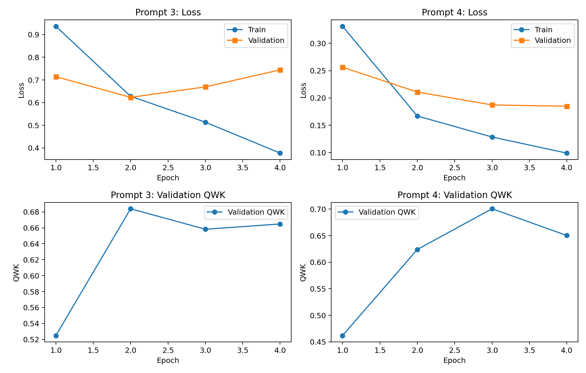
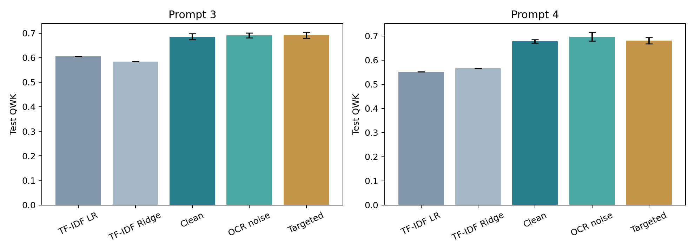

# 实验与验收报告

全部数值由本地真实实验记录生成。部署选择在测试集评价之前冻结；测试指标不用于继续调参。

## 数据与划分

两道题均为 0～2 分，以 Score1 为目标。train_rel_2.tsv 作为开发数据，公开测试文本按题号和 ID 与官方 solution 严格关联。去除开发数据中与测试集规范化文本重复的记录，训练／验证按文本组分层划分。

| 题目 | 训练 | 验证 | 官方测试 | 排除的测试重复开发记录 |
|---|---:|---:|---:|---:|
| 3 | 1447 | 361 | 406 | 0 |
| 4 | 1325 | 332 | 295 | 0 |

350 张手写图中，349 张有严格 ID 匹配的人工分数；未匹配的图不赋予分数。Prompt 3 有 175 张正常参考转录，其中按 ID 固定前 15 张供通用分行预处理开发，余下 160 张用于主 CER/WER；另外 10 张被标为转录异常或越界，不纳入主 OCR 指标。OCR 开发集没有参与评分模型训练或调参。Prompt 4 未附参考转录，不报告其真实 CER/WER。

## 评分模型

| 题目 | 部署任务 | 测试 QWK | MAE | RMSE | Accuracy | QWK bootstrap 95% CI |
|---|---|---:|---:|---:|---:|---|
| 3 | classification | 0.6859 | 0.2685 | 0.5276 | 0.7365 | [0.6167344997357729, 0.746764046346143] |
| 4 | regression | 0.6790 | 0.2542 | 0.5042 | 0.7458 | [0.6068444594785731, 0.7453464462974179] |

bootstrap 区间对当前冻结预测按样本重采样，不能反映所有训练随机性或跨学校泛化。每题先正式微调分类／回归，再各做 3 次 Optuna 受控搜索（共 12 个 trial），搜索学习率、batch、epoch、weight decay、dropout 和 max length。搜索预算小，不宣称全局最优。

原问题与版本化紧凑评分标准占输入前半预算，后半留给答案。完整 rubric 在 configs/prompts.json 和网页中保留。所有 DistilBERT 层参与训练，BF16（支持时）、AdamW、线性 warmup/scheduler、gradient clipping、early stopping，按验证 QWK 保存最佳轮。

### 基线与分类／回归初始对比

| 题目 | 方法 | 验证 QWK | 测试 QWK | 测试 MAE |
|---|---|---:|---:|---:|
| 3 | distilbert_classification | 0.6574 | 0.7152 | 0.2389 |
| 3 | distilbert_regression | 0.6367 | 0.6746 | 0.2857 |
| 3 | tfidf_logistic | 0.5317 | 0.6057 | 0.2931 |
| 3 | tfidf_ridge | 0.5544 | 0.5832 | 0.2956 |
| 4 | distilbert_classification | 0.5850 | 0.6878 | 0.2271 |
| 4 | distilbert_regression | 0.6457 | 0.6954 | 0.2441 |
| 4 | tfidf_logistic | 0.5741 | 0.5512 | 0.2949 |
| 4 | tfidf_ridge | 0.5561 | 0.5659 | 0.2915 |

### 随机种子与 OCR 噪声消融

在各题验证集选出的任务和配置上，分别以 42、123、2026 三个种子训练原始文本与通用 OCR 字符混淆／丢字符增强模型。每次取样以 50% 概率使用噪声副本，保持训练样本数及每轮优化步数相同；两组都使用相同早停规则，实际训练轮数可能不同。增强仅使用训练集，噪声规则不来自测试图。按三个种子平均验证 QWK 选择模型族，部署该族预先指定 seed=42 的模型。

| 题目 | 模型族 | 验证 QWK 均值 ± 样本标准差 | 测试 QWK 均值 ± 样本标准差 |
|---|---|---|---|
| 3 | repeat_clean | 0.6730 ± 0.0128 | 0.6856 ± 0.0121 |
| 3 | repeat_noise | 0.6635 ± 0.0053 | 0.6909 ± 0.0096 |
| 3 | repeat_targeted | 0.6686 ± 0.0213 | 0.6918 ± 0.0121 |
| 4 | repeat_clean | 0.6827 ± 0.0166 | 0.6781 ± 0.0073 |
| 4 | repeat_noise | 0.6681 ± 0.0125 | 0.6974 ± 0.0185 |
| 4 | repeat_targeted | 0.6827 ± 0.0073 | 0.6809 ± 0.0137 |

题目 3 最终选择 `repeat_clean`。这是当前预算下平均验证表现的选择，不证明某种增强方法普遍有效或无效；三种种子的差异不等同于统计显著性检验。
题目 4 最终选择 `repeat_clean`。这是当前预算下平均验证表现的选择，不证明某种增强方法普遍有效或无效；三种种子的差异不等同于统计显著性检验。

repeat_clean 为原始训练，repeat_noise 为同预算噪声增强，repeat_targeted 为噪声增强加针对性损失：训练集频数计算平方根逆频率权重；分类另加 0.3 倍的期望分数 MSE，回归采用加权 MSE。该项只能归因于组合改进，未单独分离各损失的因果贡献。增强是否有效以表中实际结果为准，不强制宣称改进。各次训练仅保证随机种子、版本与记录可追溯，GPU 运算不保证跨设备逐位一致。

## OCR 与端到端评价

- 题目 3：识别 185 张；具有正常参考转录的样本 160，CER=0.10047696089761099，WER=0.3391812865497076。
- 题目 3 核验参考转录配对：n=160，文本 QWK/MAE=0.6697247706422018/0.28125，OCR QWK/MAE=0.5522388059701493/0.3625。
- 该配对中，OCR 导致预测分数变化的比例为 11.25%；绝对评分误差增加 9.38%，偶然降低 1.88%，平均新增绝对误差 0.0813。
- CER 与新增绝对评分误差的 Spearman 相关为 0.3250500666832215；按 CER 分组的真实评分指标见 OCR metrics.json，不把所有字符错误视为同等影响。
- 题目 3 原始 ASAP 文本代理配对：n=185，文本 QWK/MAE=0.6745936818405684/0.2702702702702703，OCR QWK/MAE=0.5694747771293545/0.34054054054054056。
- 该配对中，OCR 导致预测分数变化的比例为 9.73%；绝对评分误差增加 8.11%，偶然降低 1.62%，平均新增绝对误差 0.0703。
- 题目 4：识别 165 张；具有正常参考转录的样本 0，CER=None，WER=None。
- 题目 4 核验参考转录配对：n=0，文本 QWK/MAE=None/None，OCR QWK/MAE=None/None。
- 题目 4 原始 ASAP 文本代理配对：n=164，文本 QWK/MAE=0.7312576812781646/0.1951219512195122，OCR QWK/MAE=0.6427964300892477/0.25。
- 该配对中，OCR 导致预测分数变化的比例为 9.15%；绝对评分误差增加 7.32%，偶然降低 1.83%，平均新增绝对误差 0.0549。

CER/WER 采用 NFKC、小写、空白归一化，保留标点，以参考字符／词总数做微平均；OCR 使用官方 TrOCR-small-handwritten 权重，按水平投影分行后批量识别。未在本项目微调 OCR。Prompt 4 的原始 ASAP 文本仅是代理对照，不能据此证明转录一致。手写数据是对原答案的转写，不等同于真实课堂独立作答，域差异仍需自采测试。

## 评分置信度与复核

模型 softmax 最大值／回归输出距最近合法整数的启发式量只用于排序，不是评分正确率。阈值只由验证集选择，要求至少 30 个自动接受样本、精确一致率 ≥85%、误差不超过 1 分的一致率 ≥98%；找不到满足条件的阈值则全部复核。该经验规则不是可靠性保证，阈值选择与模型选择共用验证集，存在乐观偏差。

- 题目 3：阈值 0.860801；测试自动覆盖率 20.20%，复核覆盖率 79.80%；自动子集实际精确一致率 0.8414634146341463，误差≤1分一致率 0.9878048780487805。
- 题目 3 的测试自动子集精确一致率低于验证阶段的 85% 目标；保留该结果，不利用测试集反调阈值。阈值不是正确率保证。
- 题目 4：阈值 0.601649；测试自动覆盖率 57.29%，复核覆盖率 42.71%；自动子集实际精确一致率 0.8461538461538461，误差≤1分一致率 1.0。
- 题目 4 的测试自动子集精确一致率低于验证阶段的 85% 目标；保留该结果，不利用测试集反调阈值。阈值不是正确率保证。

上述覆盖率针对文本评分；手写 OCR 的错误会改变分数，因此 Demo 对图片评分均提示教师核对。空白、非英文、过长、OCR 异常及不支持题目有明确处理。

## 产物位置

- 评分评价：`experiments/20261030-024433-269665_frozen_evaluation`，包含逐样本测试预测、混淆矩阵、误差 CSV、全部对比和随机种子结果。
- OCR 评价：`experiments/20261030-024544-175299_handwriting_evaluation`，包含每张图识别文本、行框、参考状态、CER/WER 计数和评分变化。
- 权重与冻结版本：`models/registry.json` 及其指向的独立题目目录。
- 训练记录：`experiments/*/run.json`、`history.json`、`summary.json`、`checkpoint/`。
- 自采最终测试：`data/self_collected/`，当前没有真实小组自采样本；接口可用，但不编造该项完成或指标。

## 局限与下一步

这是受控的小样本课程实验。公开测试集可用于复现实验，不是盲测；没有独立学校／学生域的泛化证明。三种随机种子的稳定性证据有限。完整 rubric 压缩、长答案截断、分行不准和 OCR 领域差异均会影响分数。下一步应在冻结模型后收集独立自采数据，由教师标注并评价，不能据此再次调参后仍称独立测试。

## 实测算力记录

本项目累计记录 35 次训练（含短程试验和剪枝），实际执行 23472 次优化器更新；各训练运行记录耗时合计 19.06 分钟，包含轮次验证和权重保存，不含安装下载、OCR 和网页验收。硬件为 NVIDIA GeForce RTX 5060 Ti，详细记录见 compute_cost.json。

## 实际运行验收

9 项功能测试通过；Chrome 完成真实图片上传、OCR、评分、手动修改重评、批量评分与题目切换，HTTP 完成图片／文本混合批量与不支持题目拒绝测试。详见 [验收记录](验收记录.md)。

其他候选即使测试 QWK 更高，也不改变按验证集预先冻结的部署规则。
