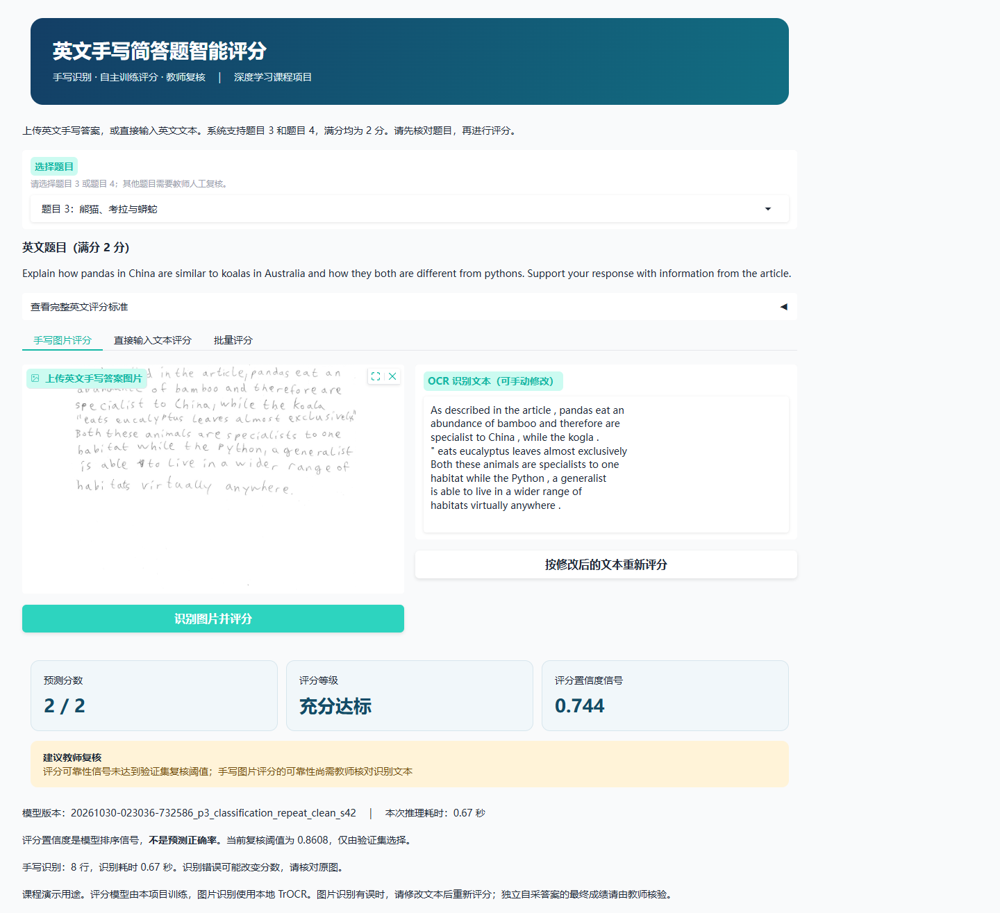
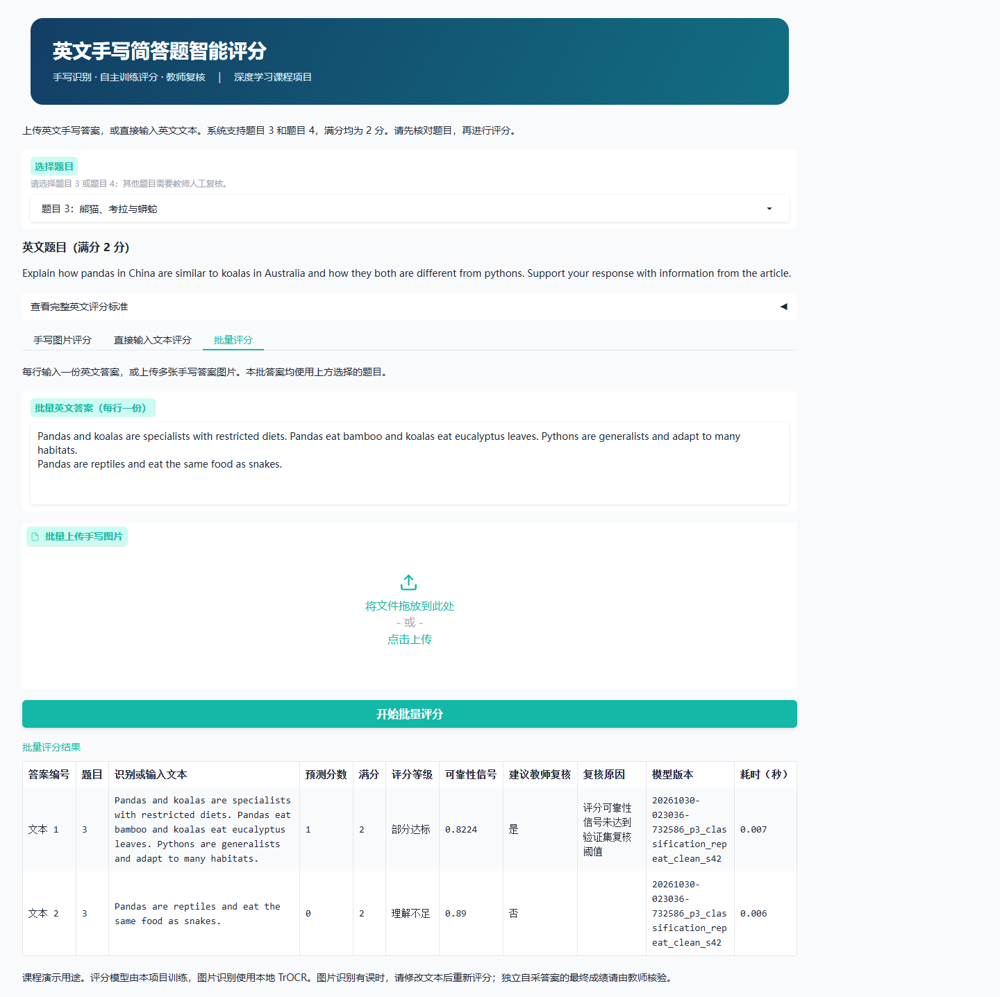
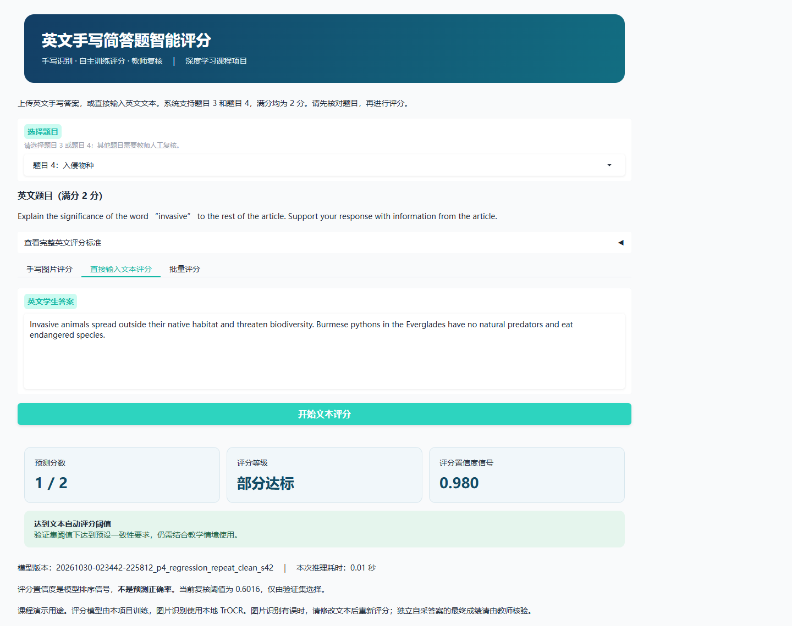

# 最终运行验收

功能测试：9 项通过，0 项失败；包含最佳权重重载与验证集预测复现。

Chrome 真实浏览器：

- 中文页面启动：通过
- 图片上传、真实 TrOCR 识别及评分：通过
- 人工修改识别文本并重新调用训练模型：通过
- 直接输入英文文本评分：通过
- 批量文本评分：通过
- 切换题目 4 并加载对应题目与评分标准：通过
- 题目 4 真实模型评分：通过

本地 HTTP：

- 题目 4 图片 OCR 和评分：通过
- 文本与图片混合批量评分：通过
- 不支持题目明确拒绝并提示复核：通过

自采接口：尚无真实小组采集样本，空输入保护已实测，不生成虚构指标。

开机后双击项目根目录的 `启动评分系统.cmd`，或按 README 启动；无需重新训练。

